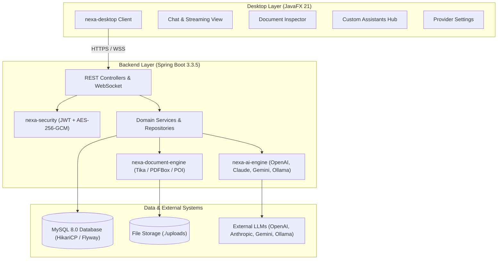

# NEXA AI — Professional Desktop AI Intelligence Assistant

<p align="center">
  
  
  
  
  
  
  
</p>

---

## 📖 Overview

**NEXA AI** is a state-of-the-art enterprise desktop AI assistant engineered in modern Java 21. Combining a sleek, responsive JavaFX desktop client with a robust Spring Boot 3 microservices backend, NEXA AI delivers multi-provider LLM orchestration, intelligent document extraction, workspace management, and enterprise-grade cryptographic security.

---

## 🏛 Architecture

NEXA AI follows a modular, decoupled multi-module architecture:



### Module Breakdown

| Module | Description | Key Technologies |
| :--- | :--- | :--- |
| **`nexa-common`** | Shared domain constants, response wrappers (`ApiResponse`), error codes, and global exceptions. | Lombok, Jackson |
| **`nexa-security`** | Cryptographic engine with AES-256-GCM for API keys, stateless JWT authentication, and Spring Security 6 RBAC. | JJWT 0.12.5, JCA AES/GCM |
| **`nexa-ai-engine`** | Provider abstraction layer supporting multi-LLM orchestration, token estimation, fallback mechanisms, and streaming. | OkHttp 4, Jackson, SSE |
| **`nexa-document-engine`** | Multi-format document parser extracting structured text and summaries from PDFs, Office docs, and code files. | Apache Tika 2.9, Apache PDFBox 3.0, Apache POI 5.3 |
| **`nexa-backend`** | Core Spring Boot application exposing RESTful APIs, WebSocket streaming endpoints, JPA repositories, and Flyway migrations. | Spring Boot 3.3.5, Hibernate 6, HikariCP, Flyway |
| **`nexa-desktop`** | Modern desktop interface with dark/light themes, markdown rendering, syntax highlighting, and conversation history. | JavaFX 21, ControlsFX, RichTextFX, Ikonli |

---

## ✨ Key Features

- **Multi-LLM Provider Orchestration**: Seamlessly connect OpenAI (GPT-4o, o1), Anthropic Claude (Claude 3.5 Sonnet), Google Gemini (Gemini 1.5 Pro / Flash), and local Ollama instances.
- **Enterprise Security**:
  - Passwords hashed using standard BCrypt with cost factor 10.
  - LLM API keys encrypted at rest using **AES-256-GCM** with authenticated 128-bit tags.
  - Stateless JWT authentication with short-lived access tokens and revocable refresh tokens.
- **Intelligent Document Processing**:
  - Extract and analyze PDFs, Word documents (`.docx`), Excel spreadsheets (`.xlsx`), CSVs, Markdown, and JSON files up to 50MB.
  - Automatic summarization and contextual injection into chat prompts.
- **Projects & Workspaces**: Group conversations, upload project-specific reference documents, and define custom instructions per project.
- **Custom AI Assistants**: Create and share specialized AI personas with predefined system prompts, temperature controls, and emoji badges.
- **Automated Database Migrations**: 100% Flyway-managed schema evolution with audit logging, usage tracking, and index optimizations.

---

## 🗄 Database Schema

The persistence layer uses MySQL 8.0 with binary UUID primary keys (`BINARY(16)`), foreign key constraints with cascading deletes, and optimized compound indexes:

1. **`roles`**: System roles (`ROLE_USER`, `ROLE_ADMIN`).
2. **`users`**: User accounts, credentials, and profile attributes.
3. **`user_roles`**: Many-to-many relationship mapping users to security roles.
4. **`user_settings`**: Per-user preferences (themes, language, default model/temperature, retention).
5. **`refresh_tokens`**: Rotating refresh tokens with revocation and device metadata.
6. **`ai_providers`**: User-configured AI provider endpoints and encrypted API keys.
7. **`conversations`**: Thread metadata, favorite/archived status, and message counters.
8. **`messages`**: Individual user, assistant, and system messages with token usage statistics.
9. **`ai_projects`**: Workspace containers for grouped conversations and uploaded documents.
10. **`project_conversations`**: Join table associating conversations with projects.
11. **`uploaded_files`**: Document storage records with extracted full text and summaries.
12. **`custom_assistants`**: Tailored AI assistant templates and usage counters.
13. **`notifications`**: User alerts for async AI generation, document readiness, and errors.
14. **`ai_usage_logs`**: Token consumption, latency, and model metrics for auditing.
15. **`audit_logs`**: Security audit log tracking system actions, client IPs, and status.

---

## 🚀 Getting Started

### Prerequisites

- **Java Development Kit (JDK) 21** or higher
- **Maven 3.9+**
- **Docker & Docker Compose** (or local MySQL 8.0)

---

### Option 1: Docker Compose (Recommended for Backend)

Start the MySQL database and the backend service in a single command:

```bash
cd docker
docker compose up -d
```

Verify services are healthy:
```bash
docker compose ps
curl http://localhost:8080/actuator/health
```

To view backend application logs:
```bash
docker compose logs -f backend
```

---

### Option 2: Local Development Setup

#### 1. Start MySQL 8.0
Ensure a local MySQL instance is running on `localhost:3306` with database `nexa_ai`:
```sql
CREATE DATABASE IF NOT EXISTS nexa_ai CHARACTER SET utf8mb4 COLLATE utf8mb4_unicode_ci;
```

#### 2. Build the Multi-Module Project
From the repository root:
```bash
mvn clean install -DskipTests
```

#### 3. Launch the Backend
```bash
mvn spring-boot:run -pl nexa-backend
```
The Flyway migration scripts will run automatically on startup, creating all 15 tables and seeding the default administrator account.

#### 4. Launch the JavaFX Desktop Client
```bash
mvn javafx:run -pl nexa-desktop
```

---

## 🔐 Default Credentials

The database migration seeds an administrator account out of the box:

| Attribute | Default Value |
| :--- | :--- |
| **Email** | `admin@nexa.ai` |
| **Password** | `Admin123!` |
| **Roles** | `ROLE_ADMIN`, `ROLE_USER` |
| **Theme** | `Dark` |
| **Default Model** | `gpt-4o` |

> ⚠️ **Note**: In production environments, immediately change the administrator password and set custom values for `JWT_SECRET` and `ENCRYPTION_KEY`.

---

## 📡 API Reference Overview

The backend exposes RESTful endpoints under `/api/v1`:

### Authentication (`/api/v1/auth`)
- `POST /api/v1/auth/login` — Authenticate user and receive access & refresh tokens.
- `POST /api/v1/auth/register` — Register a new user account.
- `POST /api/v1/auth/refresh` — Refresh expired access token using a valid refresh token.
- `POST /api/v1/auth/logout` — Invalidate refresh token and clear session.

### Conversations & Chat (`/api/v1/conversations`)
- `GET /api/v1/conversations` — List user conversations with pagination.
- `POST /api/v1/conversations` — Create a new conversation thread.
- `GET /api/v1/conversations/{id}` — Fetch conversation details with messages.
- `DELETE /api/v1/conversations/{id}` — Delete conversation and associated messages.
- `POST /api/v1/conversations/{id}/messages` — Send a message and initiate AI generation.

### AI Providers (`/api/v1/providers`)
- `GET /api/v1/providers` — List configured AI providers (OpenAI, Claude, Gemini, Ollama).
- `POST /api/v1/providers` — Register and encrypt an API key for a new provider.
- `POST /api/v1/providers/{id}/test` — Test connectivity and model availability.

### Document Management (`/api/v1/files`)
- `POST /api/v1/files/upload` — Upload document (PDF, DOCX, XLSX, TXT) up to 50MB.
- `GET /api/v1/files/{id}` — Get document metadata and extracted text.

### Monitoring & Actuator
- `GET /actuator/health` — Application health check and database connectivity.
- `GET /actuator/info` — Build and version information.
- `GET /actuator/metrics` — JVM and HikariCP connection pool metrics.

---

## ⚙️ Configuration Reference

Key configuration properties (configurable via environment variables or `application.yml`):

| Property | Environment Variable | Default Value | Description |
| :--- | :--- | :--- | :--- |
| `server.port` | `PORT` | `8080` | Backend HTTP port |
| `spring.datasource.url` | `DB_HOST`, `DB_PORT`, `DB_NAME` | `localhost:3306/nexa_ai` | JDBC connection string |
| `spring.datasource.username` | `DB_USER` | `root` | MySQL username |
| `spring.datasource.password` | `DB_PASSWORD` | `rootpassword` | MySQL password |
| `nexa.jwt.secret` | `JWT_SECRET` | *(Default 256-bit string)* | HMAC-SHA256 signing key |
| `nexa.jwt.access-token-expiration-ms` | - | `900000` (15 min) | Access token lifespan |
| `nexa.jwt.refresh-token-expiration-ms`| - | `604800000` (7 days) | Refresh token lifespan |
| `nexa.encryption.key` | `ENCRYPTION_KEY` | *(32-byte default key)* | AES-256 GCM encryption key |
| `nexa.storage.upload-dir` | `UPLOAD_DIR` | `./uploads` | Local upload directory path |

---

## 🛡 Security & Privacy

- **Data Encryption**: All sensitive tokens and API keys are protected using AES-256-GCM authenticated encryption.
- **Local Fallback**: Full compatibility with Ollama ensures complete offline and local data confidentiality when handling sensitive enterprise documents.
- **No Telemetry**: NEXA AI does not transmit usage telemetry or conversational data to unauthorized third parties.

---

## 📄 License

This project is licensed under the MIT License. See [LICENSE](LICENSE) for details.
